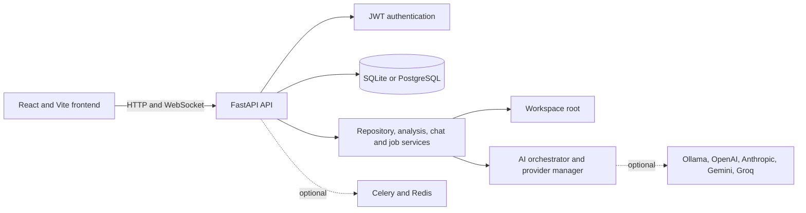

# AgentForge

AgentForge is a local-first AI software engineering workspace built around a
FastAPI API and a React/Vite interface. It combines authenticated project
management, repository browsing, analysis jobs, GitHub integration, and
provider-backed AI chat in one developer workspace.

> **Status:** Active development. Local startup and core authentication have
> been verified. AI responses remain provider- and local-service-dependent;
> this repository does not include a hosted demo or credentials.

[Architecture](docs/ARCHITECTURE.md) ·
[Security](docs/SECURITY.md) ·
[Engineering audit](docs/ENGINEERING_AUDIT.md) ·
[Mermaid diagrams](docs/diagrams/)

## Screenshots from the running application

These images were captured from the local application on 2026-10-29 using a
synthetic test account. They show genuine rendered states; provider-dependent
success states are not represented as successful.

| Screen | Preview |
| --- | --- |
| Landing page |  |
| Login |  |
| Workspace dashboard |  |
| Project workspace with empty state |  |
| Provider settings |  |
| API documentation |  |
| Mobile landing layout |  |

## What is implemented

| Capability | Status | Relevant code | Requirements |
| --- | --- | --- | --- |
| Landing, login, registration, protected workspace | Implemented | `frontend/src/pages`, `frontend/src/contexts/AuthContext.tsx` | Local API |
| Project CRUD and owner isolation | Implemented | `backend/app/api/v1/endpoints/projects.py` | Database |
| Repository file tree and content | Implemented | `backend/app/api/v1/endpoints/files.py` | Owned workspace |
| Repository analysis | Implemented, service-dependent | `backend/app/api/v1/endpoints/analysis.py` | Repository files |
| AI chat and routing | Implemented, provider-dependent | `backend/app/core/ai`, `backend/app/services/llm` | Ollama or remote key |
| GitHub clone and repository metadata | Implemented for GitHub URLs | `backend/app/api/v1/endpoints/github.py` | Git; optional token |
| Git status, branches, logs, commits | Implemented, workspace-confined | `backend/app/api/v1/endpoints/git.py` | Git |
| Terminal execution | Disabled by default | `backend/app/api/v1/endpoints/terminal.py` | Explicit opt-in; not a full sandbox |
| MCP, Celery, Redis, Qdrant | Optional/configured surfaces | `backend/app/services/mcp`, compose files | Validate separately |
| Hosted deployment and public demo | Not provided | — | Operator-owned infrastructure |

## Technology stack

- **Frontend:** React 19, TypeScript, React Router, Vite, Tailwind CSS,
  Axios, Monaco Editor, TanStack Query.
- **Backend:** Python, FastAPI, Pydantic Settings, SQLAlchemy, Alembic,
  bcrypt, JWT, WebSockets, optional Celery.
- **Data:** SQLite for local development; PostgreSQL, Redis, and Qdrant are
  optional compose services.
- **AI:** provider abstractions for Ollama, OpenAI, Anthropic, Google Gemini,
  Groq, OpenRouter, and NVIDIA NIM. Real responses require a reachable local
  service or valid provider configuration.

## Architecture



The browser calls FastAPI routes over HTTP and WebSocket connections. JWT
dependencies resolve the user before protected operations. Project and
analysis state is stored through SQLAlchemy, while repository operations are
confined to `WORKSPACE_ROOT`. The AI orchestrator selects a configured model
and normalizes provider responses.

Additional source diagrams:

- [Request lifecycle](docs/diagrams/request-lifecycle.mmd)
- [AI provider flow](docs/diagrams/ai-provider-flow.mmd)
- [Repository analysis flow](docs/diagrams/repository-analysis-flow.mmd)
- [Authentication flow](docs/diagrams/authentication-flow.mmd)
- [Deployment architecture](docs/diagrams/deployment-architecture.mmd)

## Repository layout

```text
agentforge/
├── backend/
│   ├── app/api/v1/endpoints/   # Auth, projects, files, analysis, AI and Git routes
│   ├── app/core/               # Settings, security, database and AI orchestration
│   ├── app/models/             # SQLAlchemy models
│   ├── app/services/           # Analysis, repository, provider, MCP and tool services
│   ├── tests/                  # Backend tests
│   └── requirements.txt
├── frontend/
│   ├── src/pages/              # Landing, auth and workspace pages
│   ├── src/components/         # Workspace and chat components
│   ├── src/services/           # HTTP and WebSocket clients
│   └── package.json
├── docs/
│   ├── diagrams/               # Editable Mermaid source
│   └── screenshots/            # Verified local browser captures
├── docker-compose.yml
└── README.md
```

## Local setup

### Windows PowerShell

Backend terminal:

```powershell
cd E:\agentforge\backend
py -3 -m venv .venv
.\.venv\Scripts\Activate.ps1
python -m pip install -r requirements.txt
Copy-Item .env.example .env
python -m uvicorn app.main:app --host 127.0.0.1 --port 8000 --reload
```

Frontend terminal:

```powershell
cd E:\agentforge\frontend
npm ci
npm run dev -- --host 127.0.0.1
```

Open `http://localhost:3000`. The API health check is
`http://localhost:8000/health` and Swagger UI is `http://localhost:8000/docs`.

### Linux/macOS

Use `python3 -m venv .venv`, the platform-specific activation command, and
`npm ci`. The Uvicorn and Vite commands are otherwise the same.

## Configuration reference

Copy [`backend/.env.example`](backend/.env.example) to `backend/.env`.

| Variable | Required | Purpose |
| --- | --- | --- |
| `ENVIRONMENT` | Local default | `development` enables a generated local signing key; use `production` outside local development. |
| `SECRET_KEY` | Required outside development | Random JWT signing secret, at least 32 characters. Restart after changing. |
| `DATABASE_URL` | Optional | Defaults to local SQLite; set PostgreSQL for a deployed database. |
| `CORS_ORIGINS` | Optional | Comma-separated exact browser origins, such as `http://localhost:3000`. |
| `WORKSPACE_ROOT` | Optional | Root for repository and file operations; defaults to `repos`. |
| `ENABLE_TERMINAL` | Optional | `false` by default. Enabling it is not equivalent to sandboxing. |
| `DEFAULT_AI_PROVIDER` | Optional | Defaults to `ollama`; selects the primary provider. |
| `OLLAMA_BASE_URL` | Optional | Local Ollama OpenAI-compatible endpoint. |
| `OPENAI_API_KEY`, `ANTHROPIC_API_KEY`, `GOOGLE_API_KEY`, `GROQ_API_KEY` | Optional | Remote provider credentials; never commit them. |
| `OPENROUTER_API_KEY`, `NVIDIA_NIM_API_KEY` | Optional | Additional provider credentials. |
| `CELERY_BROKER_URL`, `CELERY_RESULT_BACKEND` | Optional | Redis endpoints for background jobs. |
| `QDRANT_URL`, `QDRANT_API_KEY` | Optional | Vector-store integration settings. |

## Typical workflow

1. Register a synthetic or local developer account.
2. Sign in and open the protected workspace.
3. Create or clone a project into the configured workspace root.
4. Browse files and start repository analysis.
5. Select an AI provider and send a chat request when its service is
   configured and reachable.
6. Review analysis, jobs, monitoring, and repository results.

## API surface

Swagger/OpenAPI is generated at `/docs` when the backend is running. The main
route groups are `/auth`, `/projects`, `/files`, `/analysis`, `/github`,
`/git`, `/chats`, `/agents`, `/jobs`, `/ai-os`, `/knowledge-engine`,
`/observability`, `/terminal`, and `/tools`.

Example health request:

```powershell
Invoke-WebRequest http://localhost:8000/health
```

Example project request shape (requires a bearer token):

```json
{
  "name": "sample-repository",
  "description": "Synthetic local project",
  "branch": "main"
}
```

## Security and privacy

Passwords are hashed with bcrypt and access tokens are type-checked JWTs.
Protected project and analysis operations enforce owner checks. File, Git,
tool, and upload paths are canonicalized against the workspace; ZIP traversal
entries are rejected. CORS requires explicit origins, and terminal execution
is disabled by default.

This is not a claim of complete production security. Review
[`docs/SECURITY.md`](docs/SECURITY.md) before deployment. Keep databases,
Redis, Qdrant, Flower, workspaces, `.env` files, and provider credentials
private.

## Verification

Automated checks verified in this checkout:

```powershell
cd E:\agentforge\backend
.\.venv\Scripts\python.exe -m pytest -q
# 11 passed; one external google-generativeai deprecation warning remains

cd E:\agentforge\frontend
npm.cmd run build
# TypeScript and Vite production build passed
```

Manual browser verification on 2026-10-29:

| Flow | Result |
| --- | --- |
| Landing page, login, registration | Pass |
| Protected workspace and dashboard | Pass |
| Synthetic account persistence | Pass |
| Settings/provider selection view | Pass |
| Swagger UI | Pass |
| Mobile landing render | Pass |
| AI response | Blocked: configured provider returned HTTP 500 in this environment |
| Project/repository analysis | Not run: no synthetic repository was created |

The registration error-rendering bug found during browser testing was fixed by
normalizing structured FastAPI validation errors in
`frontend/src/utils/errors.ts`.

## Troubleshooting

- **Backend does not start:** use the repository virtual environment and run
  from `backend`; check `backend/.env` without printing its values.
- **CORS errors:** set `CORS_ORIGINS` to the exact Vite origin and restart the
  backend.
- **AI HTTP 500/unavailable:** verify Ollama is running with the configured
  model, or configure a valid remote provider key. Do not treat the UI shell
  as proof of provider availability.
- **Git or file errors:** use paths below `WORKSPACE_ROOT` and ensure Git is
  installed.
- **Frontend dependency issues:** run `npm ci` from `frontend`; use
  `npm.cmd` if PowerShell blocks `npm.ps1`.
- **Docker configuration:** provide `SECRET_KEY` and `POSTGRES_PASSWORD`
  through the environment and validate with `docker compose config`.

## Limitations and future work

Alembic configuration exists but should be validated against a disposable
database before production migration use. Terminal execution is intentionally
disabled by default and the optional allowlist is not a complete sandbox.
Provider integrations need service-level tests and operational monitoring.
There is no hosted demo, selected license, or claim of production readiness.

See [`docs/ARCHITECTURE.md`](docs/ARCHITECTURE.md) and
[`docs/ENGINEERING_AUDIT.md`](docs/ENGINEERING_AUDIT.md) for design details
and remaining technical debt.

## Contributing

Create a focused branch, make a small change, add or update regression tests,
run the backend and frontend checks, and update relevant documentation. Never
commit secrets, local databases, caches, or generated environment files.

## License

No license has been selected for this repository yet. The project owner must
choose and add one before redistributing the code.
