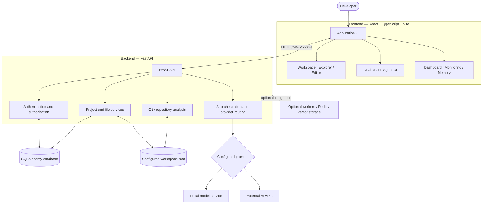
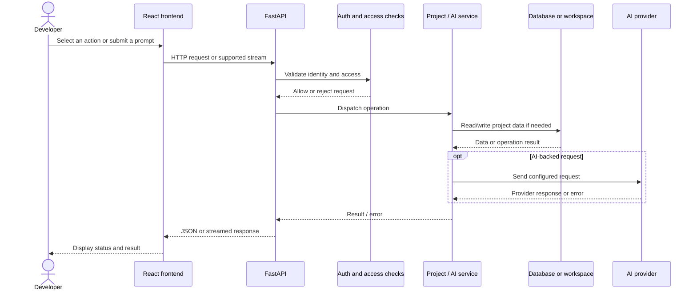
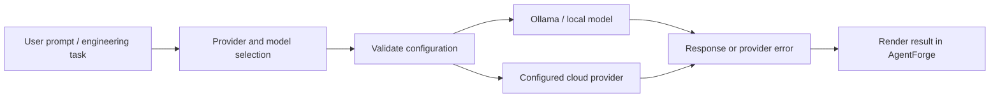

<!-- AgentForge | Project documentation -->
<div align="center">

# ⚡ AgentForge

### Your Autonomous Software Engineering Co-Pilot

**A developer workspace for exploring repositories, understanding code, coordinating focused AI engineering tasks, and connecting local or cloud language models.**

<p>
  
  
  
  
</p>

[Overview](#-overview) · [Screenshots](#-application-showcase) · [Features](#-features) · [Architecture](#-system-architecture) · [Installation](#-installation) · [Configuration](#-configuration) · [Testing](#-testing-and-validation) · [Security](#-security)

</div>

---

## 📌 Overview

**AgentForge** is a local-first AI software engineering workspace designed to bring common development activities into one interface. Instead of switching constantly between a repository browser, a code editor, a terminal, AI chat, and project diagnostics, developers can use a unified workspace to inspect code, ask contextual questions, run supported analysis tasks, and review engineering signals.

The application uses a **React + TypeScript + Vite frontend** and a **Python FastAPI backend**. The backend provides API routes for authentication, project and file workflows, repository operations, AI-related services, and other integrations supported by the current checkout.

> **Project status:** AgentForge is under active development. Local UI and core flows have been exercised. AI features depend on a reachable model and valid provider configuration. There is currently no hosted public demo; run the application locally to evaluate it.

### Why AgentForge?

- **One developer workspace:** Project navigation, file exploration, terminal access, and AI assistance are presented together.
- **Repository-aware workflows:** Work with a selected repository and use available repository-analysis functionality.
- **Provider choice:** Configure local inference or supported cloud AI providers, depending on credentials and availability.
- **Specialized engineering roles:** Access focused agent workflows for planning, repository understanding, security review, architecture, performance, and testing.
- **Operational visibility:** Review application-level activity and resource indicators when telemetry is available.
- **Local-first development:** Keep the development environment under your control and configure the workspace root deliberately.

## 🖼️ Application Showcase

The screenshots below document key parts of the application. Images are linked from the repository's `docs/screenshots/` directory so readers can open the original file. The gallery uses the screenshot assets currently referenced in this repository.

### 1. Landing page

The landing page introduces AgentForge and directs users toward the workspace or account flow.

<p align="center">
  <a href="docs/screenshots/01-landing-page.png"></a>
</p>

### 2. Authentication

The account screen provides the registration experience and a route for returning users to sign in.

<p align="center">
  <a href="docs/screenshots/02-login.png"></a>
</p>

### 3. Engineering workspace

The workspace combines project navigation, the repository explorer, a central editor area, terminal panel, and AI assistant. When no file is open, the empty state guides users toward browsing files, cloning a repository, or asking the assistant a question.

<p align="center">
  <a href="docs/screenshots/04-project-workspace.png"></a>
</p>

### 4. Engineering dashboard

The dashboard presents project and application-usage indicators in one view. These metrics are application-level signals and should not be interpreted as a provider invoice or a replacement for production observability.

<p align="center">
  <a href="docs/screenshots/03-dashboard.png"></a>
</p>

### 5. AI provider settings

The settings screen provides a place to select a provider and routing mode. A provider being listed or configured in the interface does not guarantee that credentials are valid or that the remote/local service is reachable.

<p align="center">
  <a href="docs/screenshots/10-settings-or-provider-selection.png"></a>
</p>

### 6. API documentation

FastAPI's Swagger interface exposes endpoint groups and request schemas while the backend is running. Protected endpoints may require authentication.

<p align="center">
  <a href="docs/screenshots/11-api-documentation.png"></a>
</p>

### 7. Responsive layout

Use the responsive layout as a reference for how the public landing experience adapts to a narrower viewport.

<p align="center">
  <a href="docs/screenshots/12-mobile-layout.png"></a>
</p>

> **Screenshot maintenance:** Update screenshot files and their captions together when the interface changes. Before committing screenshots, remove passwords, access tokens, API keys, personal data, and private repository details. See the repository's `docs/screenshots/` directory for the current image assets.

## ✨ Features

### 🧭 Workspace and repository explorer

The workspace is the central place to navigate a project. It brings together a repository/file explorer, editor area, terminal panel, and AI assistant.

Typical uses include:
- Opening a supported project and navigating its file tree.
- Selecting files to inspect or discuss with the assistant.
- Cloning a repository where the configured Git workflow supports it.
- Running supported project commands and reviewing their output.
- Keeping repository context visible while moving between engineering tasks.

Repository access depends on the configured workspace root, the permissions of the backend process, and Git being installed where required. Begin with a non-sensitive test repository before using a real project.

### 📊 Engineering dashboard

The dashboard provides a quick overview of project activity and application-level indicators. Depending on available backend data, these may include project counts, request activity, token usage, estimated cost, and recent workspaces.

**Important:** Dashboard values are not a substitute for billing records from an AI provider, a system monitoring platform, or verified production telemetry.

### 🤖 Multi-agent engineering workflows

The Agents area presents specialized engineering roles that can help structure work into focused tasks. The interface includes roles such as:

| Agent role | Intended responsibility |
|---|---|
| **Planner Agent** | Break a broad engineering request into smaller steps |
| **Repository Agent** | Help navigate and understand repository structure |
| **Security Agent** | Review code and flag potential security concerns |
| **Architecture Agent** | Discuss design choices and architectural improvements |
| **Performance Agent** | Identify potential bottlenecks and optimization opportunities |
| **Testing Agent** | Suggest test cases and edge cases |

The exact capabilities and output quality depend on the backend implementation, selected provider/model, and the context supplied to each task. Review agent output before applying code changes; an agent card or running indicator alone does not prove that a task completed successfully.

### 💬 AI chat and provider routing

AgentForge provides a shared interface for code-related questions and model selection. Depending on local configuration, provider surfaces include Ollama and external providers such as OpenAI, Google Gemini, Anthropic/Claude, Groq, OpenRouter, and NVIDIA NIM.

- **Local inference:** Ollama can run models on a developer's machine when installed and configured.
- **Cloud inference:** External providers require valid API credentials and network connectivity.
- **Model routing:** Choose a supported provider/model or a routing mode exposed by the application.
- **Troubleshooting:** If a request fails, verify the provider URL, selected model, credentials, network access, and backend logs.

A model shown in a dropdown is not proof that the model is installed, enabled for your account, or currently reachable.

### 🧠 Knowledge graph and repository memory

The Knowledge Graph and Memory areas are designed to display repository structure/dependency information and stored semantic context when these features have data to show. Repository indexing, embeddings, and retrieval depend on the implementation and services configured for the current run.

Empty panels can be expected before a repository is selected, indexed, or processed. Validate the displayed information against the actual codebase rather than assuming every repository file has been indexed.

### 📈 Monitoring and operational signals

Monitoring views can surface application-level request counts, token usage, estimated cost, latency, error rate, WebSocket connections, and resource indicators where data is available. Treat these values as diagnostic aids rather than a guarantee of complete system observability.

### 🔌 API documentation

When the backend is running, interactive API documentation is available at:

- Swagger UI: `http://localhost:8000/docs`
- OpenAPI schema: `http://localhost:8000/openapi.json`

Routes and schemas may change during active development. Protected routes may require a valid authenticated session or token.

## 🔄 Typical developer workflow

1. Start the backend and frontend in separate terminals.
2. Register or sign in using the local development authentication flow.
3. Open or clone a non-sensitive repository.
4. Confirm the selected repository and inspect its file tree.
5. Configure an AI provider and test it with a small, non-sensitive prompt.
6. Run a supported repository analysis or agent task.
7. Review the result and check backend logs if the operation fails.
8. Use monitoring and repository-memory screens after activity or indexing has produced data.
9. Verify any suggested code changes manually and with tests before merging them.

## 🏗️ System Architecture

AgentForge separates the browser UI from API handling, persistence, repository operations, and AI-provider integration. Optional services are only available when they are configured and running.

### High-level component diagram



### Request lifecycle



### AI provider routing



The diagrams describe the intended high-level flow. The exact route behavior, provider support, persistence choices, and optional-service wiring should be verified against the current source and environment.

### Architecture documentation

- [Architecture overview](docs/ARCHITECTURE.md)
- [System architecture source](docs/diagrams/system-architecture.mmd)
- [Authentication flow](docs/diagrams/authentication-flow.mmd)
- [AI provider flow](docs/diagrams/ai-provider-flow.mmd)
- [Repository analysis flow](docs/diagrams/repository-analysis-flow.mmd)
- [Request lifecycle](docs/diagrams/request-lifecycle.mmd)
- [Deployment architecture](docs/diagrams/deployment-architecture.mmd)

## 🧰 Technology Stack

| Layer | Technologies / components |
|---|---|
| Frontend | React 19, TypeScript, Vite |
| UI and navigation | React Router, Tailwind CSS, reusable React components |
| Data fetching | TanStack Query, Axios |
| Code editor | Monaco Editor |
| Backend API | Python, FastAPI, Pydantic Settings |
| Persistence | SQLAlchemy; SQLite for local development and PostgreSQL-compatible configuration |
| Authentication | bcrypt password hashing, JWT access tokens |
| AI integrations | Ollama and configured external provider APIs |
| Optional integrations | WebSockets, Celery, Redis, Qdrant, Docker Compose |
| Testing | pytest and frontend production build tooling |

The list describes the stack represented by the project documentation and configuration. Individual integrations may require extra packages, services, credentials, or environment variables.

## 📁 Repository Layout

```text
AgentForge/
├── backend/
│   ├── app/
│   │   ├── api/v1/endpoints/   # API route modules
│   │   ├── core/               # Settings, database and security
│   │   ├── models/             # SQLAlchemy models
│   │   ├── schemas/            # Request and response schemas
│   │   └── services/            # Project, repository and AI services
│   ├── tests/                  # Backend tests
│   ├── .env.example            # Backend configuration template
│   └── requirements.txt
├── frontend/
│   ├── src/pages/              # Main application screens
│   ├── src/components/         # Reusable UI components
│   ├── src/services/           # API integrations
│   └── package.json
├── docs/
│   ├── diagrams/               # Mermaid source diagrams
│   ├── screenshots/            # Application screenshots
│   ├── ARCHITECTURE.md
│   ├── ENGINEERING_AUDIT.md
│   └── SECURITY.md
├── docker-compose.yml
├── START_AGENTFORGE.bat
├── START_AGENTFORGE.ps1
└── README.md
```

## ⚙️ Installation

### Prerequisites

Install the following before running the application:

- **Python 3.11 or newer** recommended for the backend.
- **Node.js and npm** compatible with the frontend dependencies.
- **Git** for repository workflows.
- A terminal: PowerShell on Windows, or a shell on macOS/Linux.
- Optional: Ollama or cloud AI credentials for provider-backed chat.
- Optional: Redis, Qdrant, PostgreSQL, or Docker services if your selected features need them.

### 1. Clone the repository

```bash
git clone https://github.com/Varshith0105/AgentForge.git
cd AgentForge
```

> **Access note:** If the repository is private, you must be signed in with a GitHub account that has permission to clone it.

### 2. Create the backend environment

From the repository root, in Windows PowerShell:

```powershell
cd backend
py -3 -m venv .venv
.\.venv\Scripts\Activate.ps1
python -m pip install --upgrade pip
pip install -r requirements.txt
Copy-Item .env.example .env
```

On macOS/Linux, create and activate the virtual environment with `python3 -m venv .venv` and `source .venv/bin/activate`, then install `requirements.txt` and copy `.env.example` to `.env`.

Edit `backend/.env` for your machine. Do not commit this file.

### 3. Start the backend API

From the `backend` directory, with the virtual environment active:

```powershell
python -m uvicorn app.main:app --host 127.0.0.1 --port 8000 --reload
```

Verify the backend endpoints:

- Health check: `http://localhost:8000/health`
- Swagger UI: `http://localhost:8000/docs`
- OpenAPI schema: `http://localhost:8000/openapi.json`

If the health endpoint differs in your checkout, consult the API routes and backend logs.

### 4. Install and start the frontend

Open a second terminal at the repository root:

```powershell
cd frontend
npm ci
npm run dev
```

Open the local URL printed by Vite. If PowerShell blocks the `npm.ps1` shim, try `npm.cmd ci` and `npm.cmd run dev`. Do not change a machine-wide execution policy simply to run the frontend.

### 5. Configure a model provider

Choose a provider supported by the current configuration. For local inference, install and start Ollama and make sure the selected model is available. For cloud providers, add the required API key to your local backend environment and restart the backend.

Start with a simple prompt that does not include confidential source code, credentials, or customer data.

### 6. Run the first workflow

1. Register or sign in.
2. Open a project or clone a test repository.
3. Confirm the workspace root and file tree.
4. Test a small file-exploration or repository task.
5. Configure AI chat and verify a small prompt.
6. Review logs and test output before relying on the result.

### Helper scripts

The repository includes Windows helper scripts such as `START_AGENTFORGE.bat` and `START_AGENTFORGE.ps1`. Read the script contents before execution and confirm that their paths, ports, and environment assumptions match your setup.

## 🔧 Configuration

Use [`backend/.env.example`](backend/.env.example) as the source of truth for supported variable names and defaults. The following table explains common settings; not every variable is required for every workflow.

| Setting | Purpose |
|---|---|
| `ENVIRONMENT` | Runtime mode for local development or deployment |
| `SECRET_KEY` | Secret used for token signing; keep private and use a strong random value |
| `DATABASE_URL` | Database connection string |
| `CORS_ORIGINS` | Explicit frontend origins allowed by the backend |
| `WORKSPACE_ROOT` | Root directory for supported file/repository operations |
| `ENABLE_TERMINAL` | Controls whether terminal execution is enabled, where implemented |
| `DEFAULT_AI_PROVIDER` | Default AI provider selection |
| `OLLAMA_BASE_URL` | Ollama server URL when using local inference |
| `OPENAI_API_KEY` | Optional OpenAI API credential |
| `GEMINI_API_KEY` | Optional Google Gemini API credential |
| `CLAUDE_API_KEY` | Optional Anthropic credential |
| `GROQ_API_KEY` | Optional Groq credential |
| `OPENROUTER_API_KEY` | Optional OpenRouter credential |
| `NVIDIA_NIM_API_KEY` | Optional NVIDIA NIM credential |
| `REDIS_URL` / `CELERY_BROKER_URL` | Optional background task infrastructure |
| `QDRANT_URL` | Optional vector database endpoint |

Generate a random secret locally if required:

```powershell
python -c "import secrets; print(secrets.token_urlsafe(32))"
```

**Secrets checklist**
- Keep real API keys only in local environment files or a secret manager.
- Never commit populated `.env` files.
- Do not paste secrets into prompts, screenshots, issues, or logs.
- Rotate credentials immediately if they are accidentally exposed.

## 🧪 Testing and Validation

Run backend tests from the `backend` directory with the project virtual environment active:

```powershell
python -m pytest -q
```

Run a frontend production build:

```powershell
cd frontend
npm ci
npm run build
```

For the most reliable result, test from a clean checkout and record the Python and Node versions. Optional integrations such as external AI providers, Redis/Celery, Qdrant, and GitHub operations need separate integration checks with their required services configured.

The engineering notes in [`docs/ENGINEERING_AUDIT.md`](docs/ENGINEERING_AUDIT.md) describe previously checked flows. Treat those as a snapshot, not as proof that every provider or optional service is healthy in your environment. Provider-backed chat can fail even when the UI loads correctly.

### Suggested validation checklist

- [ ] Backend starts without import or configuration errors.
- [ ] Frontend development server and production build succeed.
- [ ] Registration, login, logout, and protected routes behave as expected.
- [ ] Project and file operations stay inside the intended workspace.
- [ ] AI requests work with the selected provider and model.
- [ ] Invalid credentials and unavailable providers produce understandable errors.
- [ ] Agent output is reviewed and verified with tests.
- [ ] No secrets or private user data are present in screenshots or logs.

## 🔐 Security

AgentForge interacts with source code, filesystem paths, credentials, and external AI services. Run it with the least privilege practical for your development workflow.

Read [`docs/SECURITY.md`](docs/SECURITY.md) before exposing the service beyond your local machine.

Security-related implementation documented by the project includes password hashing, token validation, ownership checks, workspace path restrictions, archive path validation, explicit CORS configuration, and terminal execution disabled by default. The exact behavior must be checked against the current source and deployment configuration.

> **Security warning:** AgentForge is in active development and is not represented as production-hardened. A command allowlist is not a complete operating-system sandbox. Before deployment, configure TLS, secret management, rate limiting, service access controls, audit logging, secure database access, and appropriate isolation. Do not expose Redis, Qdrant, Flower, databases, or private workspace files directly to the public internet.

### Safe-use recommendations

1. Use a dedicated development account and a test repository first.
2. Keep the workspace root narrow and avoid sensitive directories.
3. Keep terminal execution disabled unless you understand the implications.
4. Never run unreviewed AI-generated commands or code automatically.
5. Avoid sending proprietary code or personal data to cloud providers unless permitted by your policy.
6. Use environment-specific credentials and rotate exposed secrets.
7. Bind local development services to localhost unless remote access is intentionally configured.

## 🩺 Troubleshooting

<details>
<summary><strong>Backend fails to start</strong></summary>

Activate the virtual environment, install the requirements, and run Uvicorn from the `backend` directory. Read the first traceback in the terminal; missing packages and invalid environment values are common starting points.
</details>

<details>
<summary><strong>Frontend cannot reach the backend</strong></summary>

Check that the backend is running on the expected port, the frontend API base URL is correct, and `CORS_ORIGINS` contains the exact frontend origin. Restart the backend after changing environment values.
</details>

<details>
<summary><strong>AI chat returns an error</strong></summary>

Confirm the selected provider, model identifier, API key, network access, and local model service status. Inspect backend logs for the provider's actual response. A visible provider option does not guarantee successful inference.
</details>

<details>
<summary><strong>Ollama model is unavailable</strong></summary>

Start Ollama, verify the configured base URL, and confirm that the selected model is installed. Check the model name against the names available in your local Ollama installation.
</details>

<details>
<summary><strong>PowerShell blocks npm</strong></summary>

Use `npm.cmd ci` and `npm.cmd run dev` in PowerShell if the npm PowerShell shim is blocked.
</details>

<details>
<summary><strong>Repository or file access fails</strong></summary>

Confirm Git is installed if required, the repository path exists, and the backend process has permission to access it. Ensure the selected directory is within the configured workspace root.
</details>

## 🗺️ Roadmap and current scope

AgentForge is actively evolving. The priorities below are useful engineering directions rather than guarantees of a release date.

- Improve provider-level integration tests and clearer provider error reporting.
- Expand end-to-end coverage for repository and agent workflows.
- Validate optional Redis/Celery and vector-storage integrations independently.
- Continue improving accessibility, responsive behavior, and screenshot documentation.
- Strengthen operational controls and security hardening before any public deployment.
- Keep architecture and configuration documentation synchronized with implementation.

## 📚 Documentation

- [Architecture overview](docs/ARCHITECTURE.md)
- [Security guide](docs/SECURITY.md)
- [Engineering audit](docs/ENGINEERING_AUDIT.md)
- [System architecture diagram](docs/diagrams/system-architecture.mmd)
- [Authentication flow](docs/diagrams/authentication-flow.mmd)
- [AI provider flow](docs/diagrams/ai-provider-flow.mmd)
- [Repository analysis flow](docs/diagrams/repository-analysis-flow.mmd)
- [Request lifecycle](docs/diagrams/request-lifecycle.mmd)
- [Deployment architecture](docs/diagrams/deployment-architecture.mmd)

## 🤝 Contributing

Contributions that improve reliability, security, documentation, and developer experience are welcome.

1. Create a focused branch for your change.
2. Keep changes small and explain the motivation.
3. Add or update tests where practical.
4. Run backend tests and the frontend production build.
5. Update docs, screenshots, and configuration examples when behavior changes.
6. Never commit credentials, local databases, generated caches, or private user data.

For bug reports, include the relevant steps to reproduce, expected and actual behavior, sanitized logs, and environment details. Do not attach secrets or private source code.

## 📄 License

No license is currently identified in the repository documentation. Until a license is added, do not assume the project is available for unrestricted reuse, modification, or redistribution.

---

<div align="center">

**Built for developers who want their AI engineering workflow in one workspace.**

[View AgentForge on GitHub](https://github.com/Varshith0105/AgentForge) · [Report an issue](https://github.com/Varshith0105/AgentForge/issues)

</div>
