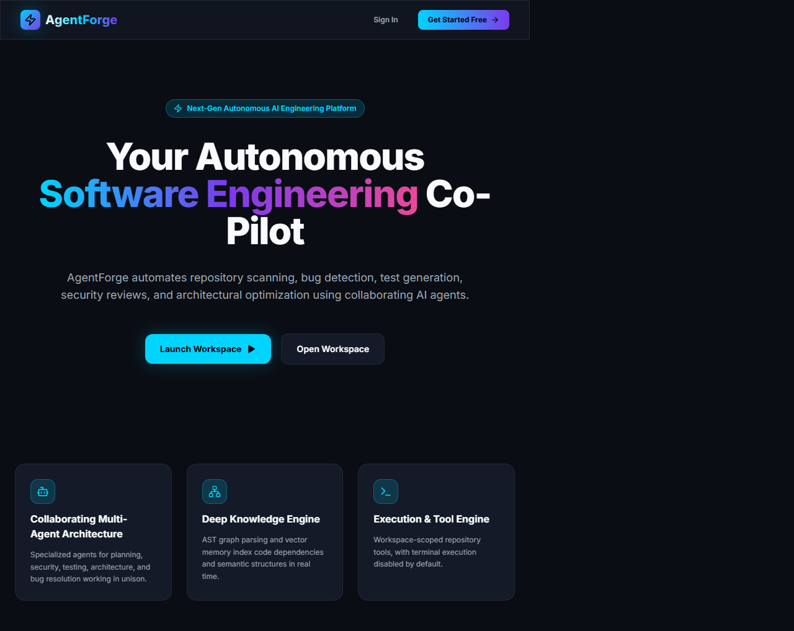
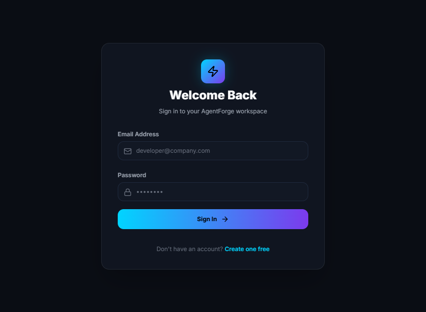
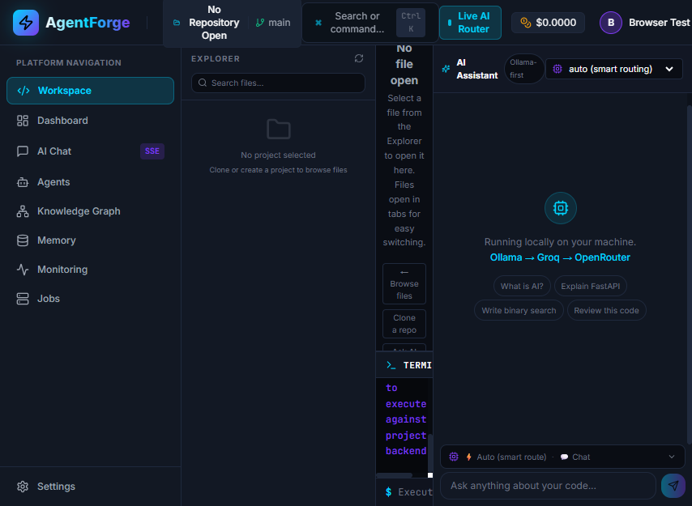
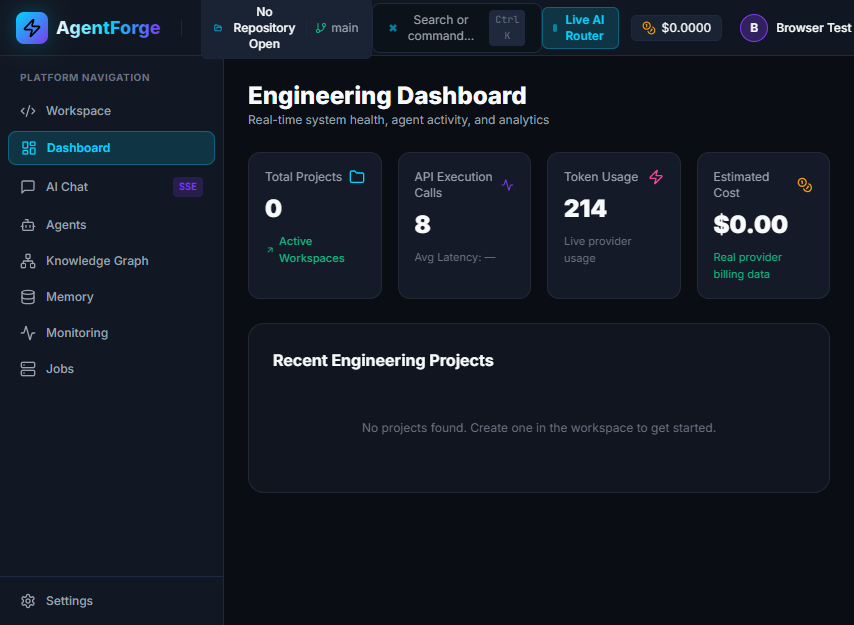
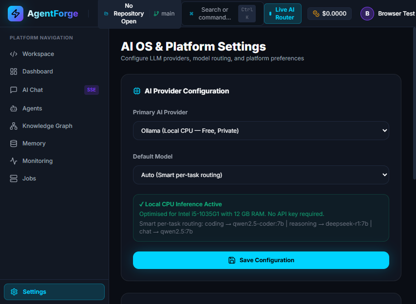
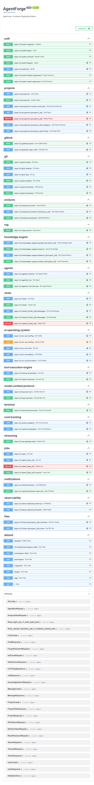
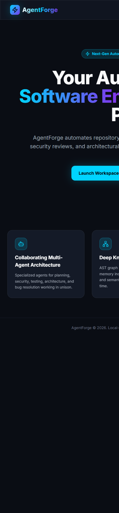
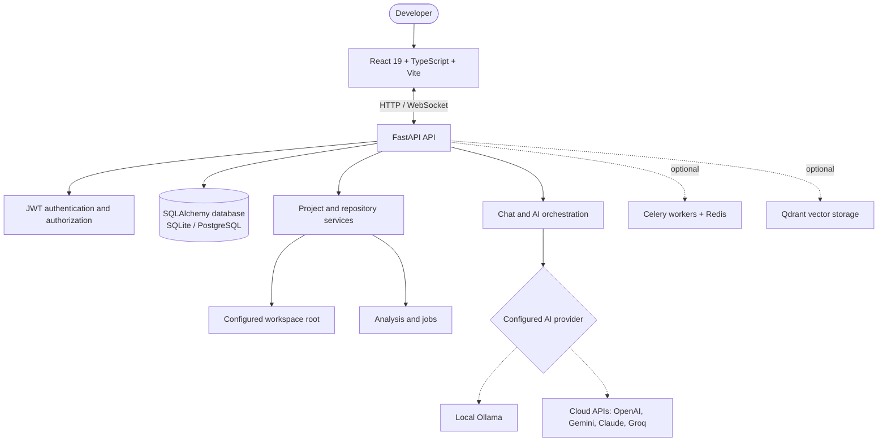
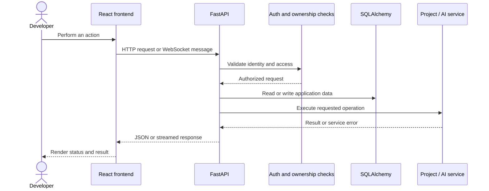

<!-- AgentForge README -->
<div align="center">
# ⚒️ AgentForge
### Your local-first AI engineering workspace.
**Explore repositories. Understand code. Run analysis. Work with AI models — from one developer workspace.**

<p>
  
  
  
  
</p>

[Features](#-what-is-agentforge) · [Screenshots](#-screenshots) · [Architecture](#-architecture) · [Setup](#-get-started) · [Configuration](#-configuration) · [Security](#-security)

</div>

---

## ✨ What is AgentForge?

AgentForge is a **local-first AI software engineering workspace** that brings project organization, repository exploration, code analysis, Git operations, and provider-backed AI chat together in one interface.

It is built with a **React + TypeScript + Vite frontend** and a **FastAPI backend**. The backend provides authenticated API routes and works with project data, files in a configured workspace, repository-analysis services, Git/GitHub integration, and optional background or vector-search services.

> **Project status:** Active development. Local UI and core flows have been exercised. AI responses depend on a reachable local model or valid external provider credentials. No hosted public demo is currently provided.

## 🚀 Core capabilities

| Capability | What it provides | Status / dependency |
|---|---|---|
| **Project workspace** | Organize projects and browse files within the configured workspace | Available; local backend and database required |
| **Repository analysis** | Start analysis jobs and inspect repository-level results | Results depend on repository contents and analysis services |
| **AI chat & provider routing** | Connect local or cloud models from one interface | Requires a working provider configuration |
| **Git & GitHub integration** | Supported repository metadata and Git operations | Git installation; optional GitHub credential |
| **Authentication** | Protected routes and user/project ownership checks | Local backend and database |
| **Optional services** | WebSockets, Celery/Redis, Qdrant and MCP-related routes | Must be configured and validated separately |

## 🖼️ Screenshots

The images below are checked into `docs/screenshots/` and document local application UI. They are not evidence of a hosted production deployment, and they do not imply that an external AI provider is currently healthy.

<table>
  <tr>
    <td width="50%"><h3 align="center">Landing page</h3><a href="docs/screenshots/01-landing-page.png"></a></td>
    <td width="50%"><h3 align="center">Sign in</h3><a href="docs/screenshots/02-login.png"></a></td>
  </tr>
  <tr>
    <td width="50%"><h3 align="center">Workspace dashboard</h3><a href="docs/screenshots/03-dashboard.png"></a></td>
    <td width="50%"><h3 align="center">Dashboard detail</h3><a href="docs/screenshots/04-dashboard-detail.png"></a></td>
  </tr>
  <tr>
    <td width="50%"><h3 align="center">Project workspace</h3><a href="docs/screenshots/04-project-workspace.png"></a></td>
    <td width="50%"><h3 align="center">AI provider settings</h3><a href="docs/screenshots/10-settings-or-provider-selection.png"></a></td>
  </tr>
  <tr>
    <td width="50%"><h3 align="center">API documentation</h3><a href="docs/screenshots/11-api-documentation.png"></a></td>
    <td width="50%"><h3 align="center">Mobile layout</h3><a href="docs/screenshots/12-mobile-layout.png"></a></td>
  </tr>
</table>

## 🧰 Technology stack

| Layer | Technologies |
|---|---|
| Frontend | React 19, TypeScript, Vite, React Router, Tailwind CSS, TanStack Query, Axios |
| Code editor | Monaco Editor |
| Backend | Python, FastAPI, Pydantic Settings, SQLAlchemy |
| Authentication | bcrypt password hashing, JWT access tokens |
| Data | SQLite for local development; PostgreSQL-compatible configuration |
| AI integrations | Ollama, OpenAI, Anthropic/Claude, Google Gemini, Groq, OpenRouter and NVIDIA NIM provider surfaces |
| Optional services | Celery, Redis, Qdrant, WebSockets, Docker Compose |

## 🏛️ Architecture

### System overview



### Request lifecycle



### Detailed diagrams

- [System architecture source](docs/diagrams/system-architecture.mmd)
- [Authentication flow](docs/diagrams/authentication-flow.mmd)
- [AI provider flow](docs/diagrams/ai-provider-flow.mmd)
- [Repository analysis flow](docs/diagrams/repository-analysis-flow.mmd)
- [Request lifecycle](docs/diagrams/request-lifecycle.mmd)
- [Deployment architecture](docs/diagrams/deployment-architecture.mmd)
- [Architecture notes](docs/ARCHITECTURE.md)

## 📁 Repository structure

```text
AgentForge/
├── backend/
│   ├── app/
│   │   ├── api/v1/endpoints/  # Auth, projects, files, AI, Git, jobs and tools
│   │   ├── core/              # Settings, database, security and AI components
│   │   ├── models/            # SQLAlchemy models
│   │   ├── schemas/           # API request/response schemas
│   │   └── services/          # Repository, analysis and provider services
│   ├── tests/                 # Backend tests
│   ├── .env.example
│   └── requirements.txt
├── frontend/
│   ├── src/pages/             # Landing, auth, dashboard and workspace pages
│   ├── src/components/        # Reusable UI components
│   ├── src/services/          # API and WebSocket integrations
│   └── package.json
├── docs/
│   ├── diagrams/              # Editable Mermaid source files
│   ├── screenshots/           # Application screenshots
│   ├── ARCHITECTURE.md
│   ├── ENGINEERING_AUDIT.md
│   └── SECURITY.md
├── docker-compose.yml
├── START_AGENTFORGE.bat
├── START_AGENTFORGE.ps1
└── README.md
```

## 🛠️ Get started

### Prerequisites

- Python 3.11+ recommended
- Node.js and npm
- Git
- Windows PowerShell, macOS Terminal, or Linux shell
- Optional: Ollama or cloud AI credentials; Redis, Qdrant and PostgreSQL if required by your selected features

### 1. Clone the repository

```bash
git clone https://github.com/Varshith0105/AgentForge.git
cd AgentForge
```

> **Repository access:** AgentForge is currently private, so your GitHub account must have permission to clone it.

### 2. Set up the backend

In Windows PowerShell:

```powershell
cd backend
py -3 -m venv .venv
.\.venv\Scripts\Activate.ps1
python -m pip install --upgrade pip
pip install -r requirements.txt
Copy-Item .env.example .env
```

Edit `backend/.env` for your local setup. SQLite is the default for local development. Configure an AI provider only if you want to use provider-backed chat.

### 3. Run the backend

From the `backend` directory with the virtual environment activated:

```powershell
python -m uvicorn app.main:app --host 127.0.0.1 --port 8000 --reload
```

- API health: [http://localhost:8000/health](http://localhost:8000/health)
- Swagger docs: [http://localhost:8000/docs](http://localhost:8000/docs)

### 4. Run the frontend

Open a second terminal at the repository root:

```powershell
cd frontend
npm ci
npm run dev
```

Open [http://localhost:3000](http://localhost:3000). If PowerShell blocks the `npm.ps1` shim, use `npm.cmd ci` and `npm.cmd run dev`.

### 5. First workflow

1. Register and sign in with a local development account.
2. Open the dashboard and create or select a project.
3. Browse files under your configured workspace root.
4. Use supported Git and repository analysis functions.
5. Configure a reachable model provider before relying on AI chat.
6. Keep terminal execution disabled unless you have reviewed the security implications.

### Windows helper scripts

The repository includes `START_AGENTFORGE.bat`, `START_AGENTFORGE.ps1`, and stop/restart helpers. Review a script before running it and ensure its assumptions match your environment.

## 🔧 Configuration

Use [`backend/.env.example`](backend/.env.example) as the configuration reference. Never commit a populated `.env` file or real API credentials.

| Variable | Purpose |
|---|---|
| `ENVIRONMENT` | Runtime environment; use a production value outside local development. |
| `SECRET_KEY` | JWT signing secret; required outside development and should be at least 32 characters. |
| `DATABASE_URL` | Database URL; SQLite is the local default, with PostgreSQL configurable. |
| `CORS_ORIGINS` | Comma-separated list of exact trusted frontend origins. |
| `WORKSPACE_ROOT` | Base directory for repository/file operations. |
| `ENABLE_TERMINAL` | Terminal execution switch; defaults to `false`. |
| `DEFAULT_AI_PROVIDER` | Primary AI provider; Ollama is the configured default. |
| `OLLAMA_BASE_URL` | Ollama service URL if using a local model. |
| `OPENAI_API_KEY`, `GEMINI_API_KEY`, `CLAUDE_API_KEY`, `GROQ_API_KEY` | Optional provider credentials. |
| `OPENROUTER_API_KEY`, `NVIDIA_NIM_API_KEY` | Optional provider credentials. |
| `REDIS_URL`, `CELERY_BROKER_URL`, `CELERY_RESULT_BACKEND` | Optional background-processing configuration. |
| `QDRANT_URL` | Optional Qdrant endpoint. |

Generate a random secret locally:

```powershell
python -c "import secrets; print(secrets.token_urlsafe(32))"
```

Copy generated secrets only to your local environment or secret manager. Do not place real credentials in source code, screenshots, issue reports, or commits.

## ✅ Tests and verification

Backend tests (run inside `backend` with the repository virtual environment):

```powershell
python -m pytest -q
```

Frontend production build:

```powershell
cd frontend
npm.cmd ci
npm.cmd run build
```

The current local engineering notes report **11 backend tests passing** and a successful frontend production build in the verified checkout. One deprecation warning from the external `google-generativeai` package remains. These are local results—not a claim that CI is configured or that production deployment has been tested.

Browser checks documented in [`docs/ENGINEERING_AUDIT.md`](docs/ENGINEERING_AUDIT.md) covered landing, authentication, protected workspace/dashboard, settings, Swagger UI, and mobile landing layout. AI chat returned HTTP 500 from the configured provider during that check. Provider-backed flows should therefore be considered environment-dependent until verified with your own configuration.

## 🔐 Security

Read [`docs/SECURITY.md`](docs/SECURITY.md) before exposing the service to a network. Current protections include bcrypt password hashing, typed JWT validation, ownership checks, workspace path restrictions, ZIP path validation, explicit CORS origins, and terminal execution disabled by default.

> **Security caveat:** AgentForge is in active development and is not described as production-hardened. The optional terminal command allowlist is not a full OS sandbox. Before deployment, configure TLS, secret management, rate limiting, service-access controls, and audit logging; keep databases, Redis, Qdrant, Flower and workspace files off public interfaces.

## 🧭 Current scope

| Area | Status |
|---|---|
| Authentication and protected workspace | Implemented; covered by local browser checks |
| Projects and workspace files | Available; validate against your own workspace |
| Repository analysis | Available; depends on files and analysis services |
| AI provider-backed chat | Integration surface implemented; requires a working provider |
| Git and GitHub operations | Available for supported operations and repository inputs |
| Terminal execution | Disabled by default; not a full sandbox when enabled |
| Redis/Celery and Qdrant | Optional; validate separately |
| Hosted public demo | Not provided |
| Production hardening | Ongoing |

Useful next steps include provider-level integration tests, database migration validation against a disposable database, stronger operational monitoring, and end-to-end checks for optional integrations.

## 🩺 Troubleshooting

<details>
<summary><strong>Backend import or module errors</strong></summary>

Run Uvicorn from `backend` with the project virtual environment activated:

```powershell
python -m uvicorn app.main:app --reload --host 127.0.0.1 --port 8000
```
</details>

<details>
<summary><strong>CORS errors in the browser</strong></summary>

Set `CORS_ORIGINS` to the exact origin shown by the frontend development server (for example, `http://localhost:3000`) and restart the backend.
</details>

<details>
<summary><strong>AI chat unavailable or returns an error</strong></summary>

Confirm the provider is selected and configured, credentials are valid if required, and the service/model is reachable. A rendered UI alone does not prove an external AI API is healthy.
</details>

<details>
<summary><strong>PowerShell blocks npm</strong></summary>

Use `npm.cmd ci` and `npm.cmd run build` instead of changing the machine-wide execution policy.
</details>

<details>
<summary><strong>Git or file operations fail</strong></summary>

Confirm Git is installed and the project is inside `WORKSPACE_ROOT`. Do not point the workspace at sensitive directories.
</details>

## 📚 Documentation

- [Architecture overview](docs/ARCHITECTURE.md)
- [Security guide](docs/SECURITY.md)
- [Engineering audit and verification](docs/ENGINEERING_AUDIT.md)
- [System architecture diagram](docs/diagrams/system-architecture.mmd)
- [AI provider flow](docs/diagrams/ai-provider-flow.mmd)
- [Repository analysis flow](docs/diagrams/repository-analysis-flow.mmd)
- [Authentication flow](docs/diagrams/authentication-flow.mmd)
- [Deployment architecture](docs/diagrams/deployment-architecture.mmd)

## 🤝 Contributing

Focused bug reports and contributions are welcome. Keep changes small, add regression tests where practical, run backend tests and the frontend build, and update docs when routes or configuration change. Never commit credentials, local databases, generated caches, or private user data.

## 📄 License

No repository license is currently selected. Until a license is added, do not assume that the code is available for unrestricted reuse or redistribution.

---

<div align="center">
**Built for developers who want their AI engineering workflow in one workspace.**

[AgentForge repository](https://github.com/Varshith0105/AgentForge) · [Report an issue](https://github.com/Varshith0105/AgentForge/issues)
</div>