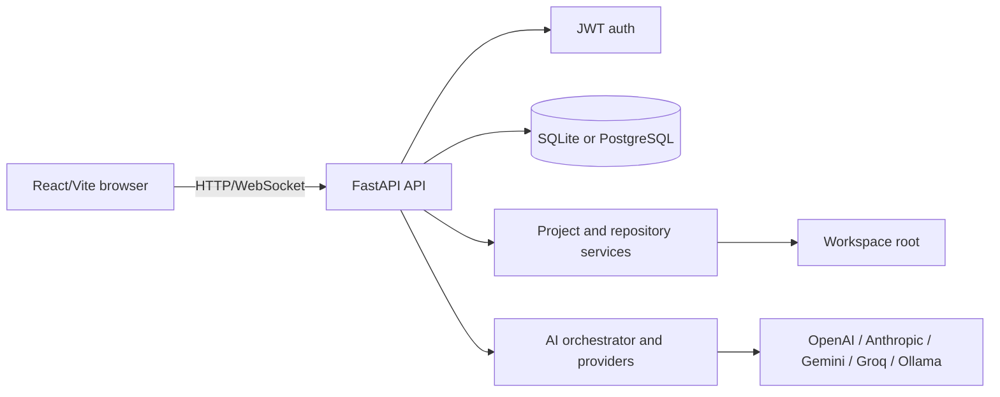

# AgentForge

AgentForge is a local-first AI software engineering workspace with a FastAPI
backend and a React/Vite frontend. It provides authenticated project
management, repository browsing, analysis jobs, chat, and optional AI provider
integrations.

> **Status:** Active development. The application is runnable locally, but
> production deployment and external provider integrations require explicit
> configuration and operational validation.

## Contents

- [Architecture](docs/ARCHITECTURE.md)
- [Security](docs/SECURITY.md)
- [Engineering audit](docs/ENGINEERING_AUDIT.md)
- [Requirements](#requirements)
- [Local setup](#local-setup)
- [Testing](#testing)
- [Configuration](#configuration)
- [Known limitations](#known-limitations)

## Implemented surface

| Area | Status | Entry points |
| --- | --- | --- |
| Landing, login, registration, workspace UI | Implemented | `frontend/src/pages`, `frontend/src/layouts` |
| Project CRUD and per-user access | Implemented | `backend/app/api/v1/endpoints/projects.py` |
| Repository file browsing | Implemented | `backend/app/api/v1/endpoints/files.py` |
| Repository analysis jobs | Implemented, provider-dependent | `backend/app/api/v1/endpoints/analysis.py` |
| AI chat and provider routing | Implemented, provider-dependent | `backend/app/services/llm`, `backend/app/core/ai` |
| GitHub cloning | Implemented for GitHub URLs | `backend/app/api/v1/endpoints/github.py` |
| Arbitrary terminal execution | Disabled by default | `backend/app/api/v1/endpoints/terminal.py` |
| Docker/Celery/Qdrant deployment | Configuration exists; verify before use | `docker-compose*.yml` |

## Architecture



## Requirements

- Python 3.11+ (the checked-in code is exercised with the repository virtual
  environment when available)
- Node.js and npm
- Git for repository operations
- Optional: Ollama or a configured remote AI provider

## Local setup

### Windows PowerShell

```powershell
cd E:\agentforge\backend
py -3 -m venv .venv
.\.venv\Scripts\Activate.ps1
python -m pip install -r requirements.txt
Copy-Item .env.example .env
python -c "import secrets; print(secrets.token_urlsafe(32))"
# Put the generated value in SECRET_KEY when ENVIRONMENT is not development.
python -m uvicorn app.main:app --reload
```

In another terminal:

```powershell
cd E:\agentforge\frontend
npm ci
npm run dev
```

Open `http://localhost:3000`. The API and Swagger UI are available at
`http://localhost:8000/health` and `http://localhost:8000/docs`.

### Linux/macOS

Use the equivalent `python3 -m venv .venv`, activation command, and
`npm ci`; the backend command remains `python -m uvicorn app.main:app --reload`.

## Configuration

Copy [`backend/.env.example`](backend/.env.example) to `backend/.env`.
`SECRET_KEY` must be at least 32 characters outside development. Set
`CORS_ORIGINS` to a comma-separated list of exact frontend origins.
`WORKSPACE_ROOT` confines repository and file operations. Terminal execution is
disabled unless `ENABLE_TERMINAL=true`; enabling it still permits only the
documented command allowlist inside that root.

AI keys are optional for local UI/API development. Configure the key matching
the provider selected by `DEFAULT_AI_PROVIDER`; Ollama is the default local
provider and must be installed separately.

## Testing

```powershell
cd E:\agentforge\backend
.\.venv\Scripts\python.exe -m pytest -q

cd E:\agentforge\frontend
npm run build
```

The commands above are the repository checks. Results depend on installed
dependencies and local services; see the engineering audit for the latest
verified baseline and remaining caveats.

## Docker

The compose files are deployment configurations, not a substitute for
securing secrets. Set `SECRET_KEY` and `POSTGRES_PASSWORD` in the environment
before running the stack. Do not expose Redis, Qdrant, or Flower publicly
without network controls.

## Known limitations

- No hosted demo or real provider credentials are included.
- Screenshot capture is intentionally omitted when a verified running
  environment is unavailable.
- The legacy `docker-compose.prod.yml` requires a separately supplied
  `.env.production`; validate it before deployment.
- No license has been added; the project owner must choose and add one.

## Contributing

Make focused changes, add regression tests for behavior changes, run the
backend and frontend checks, and update the documentation when routes or
configuration change. Never commit `.env` files, tokens, local databases, or
generated artifacts.
