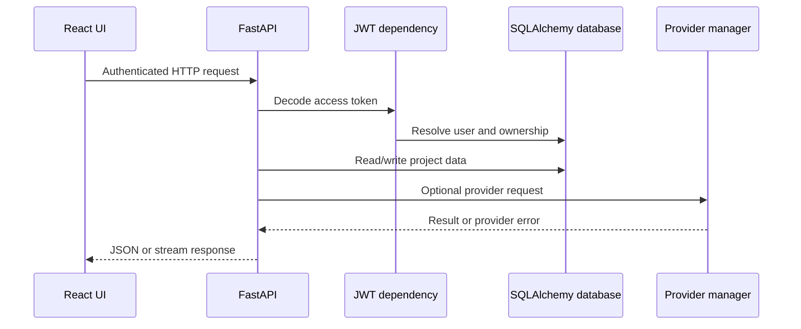

# AgentForge architecture

## System boundaries

The browser uses the React/Vite application in `frontend/src`. FastAPI routes
in `backend/app/api/v1/endpoints` provide authentication, projects, files,
analysis, chat, jobs, Git/GitHub integration, and observability. SQLAlchemy
models use SQLite for local development and can target PostgreSQL.

## Request lifecycle

## Backend layers

- `core`: settings, database, security, AI orchestration, and WebSocket
  coordination.
- `api`: HTTP routing and request validation.
- `models` and `schemas`: persistence and API data shapes.
- `services`: repository parsing, analysis, chat, reports, RAG, MCP, and
  provider abstractions.
- `tasks`: optional Celery background work.

## Trust boundaries and limitations

JWT authentication is required for project and tool routes. Project queries
must include the authenticated owner. Repository paths are confined to
`WORKSPACE_ROOT`; terminal execution is disabled by default and uses
`shell=False` when explicitly enabled. External AI and GitHub services remain
separate trust boundaries and require operator-supplied credentials.

The current application initializes tables with `Base.metadata.create_all`;
Alembic configuration exists but should be validated before production
migrations. See [`docs/SECURITY.md`](SECURITY.md) for deployment concerns.
